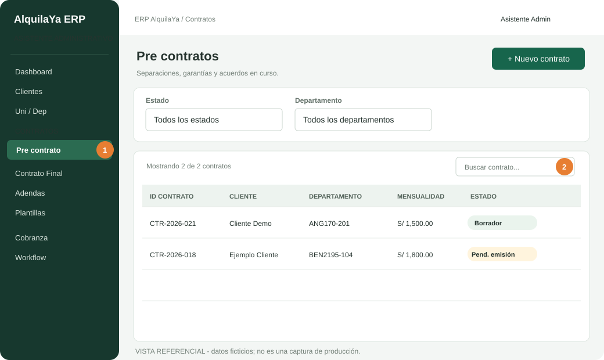
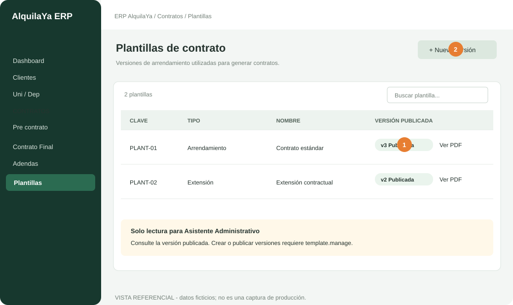
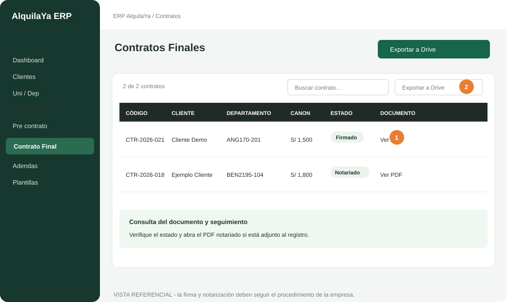
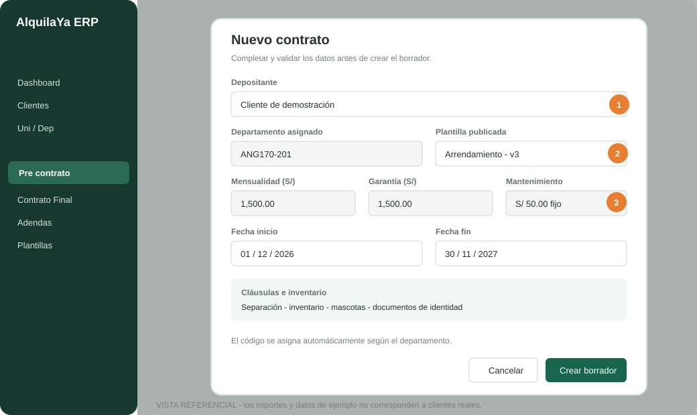
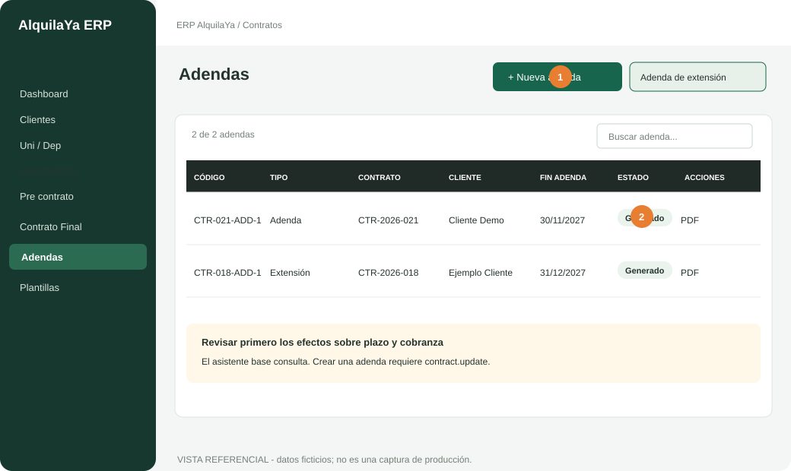
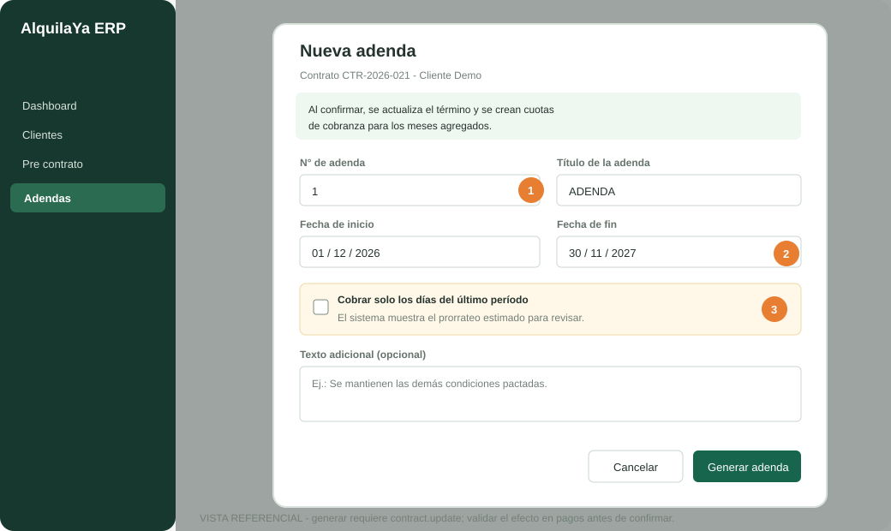
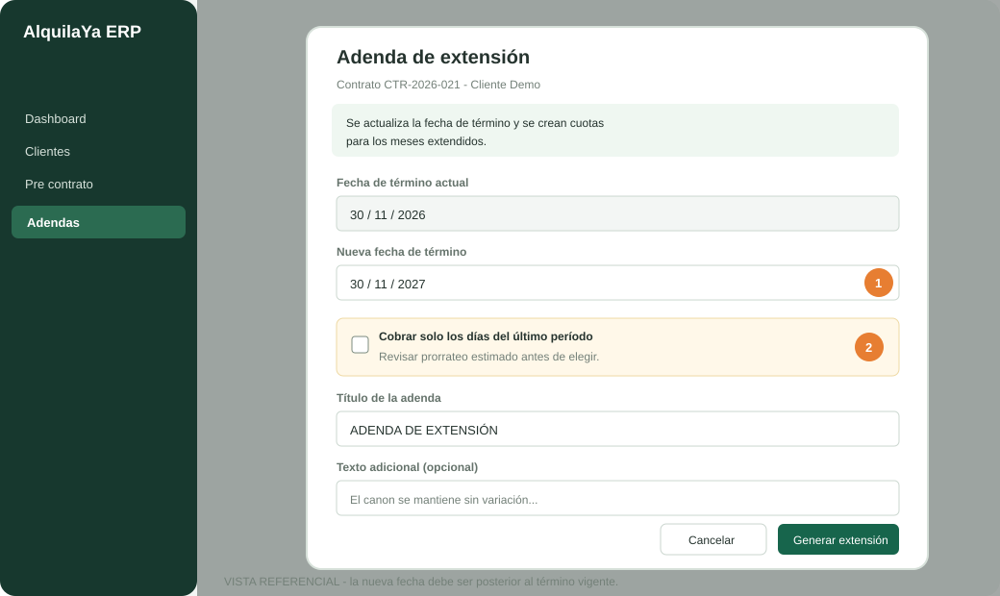

# Manual de usuario del ERP AlquilaYa
## Asistente Administrativo

**Guía operativa · Versión 1.1 · 3 de noviembre de 2026**

Este manual explica el uso del ERP desde el rol **Asistente Administrativo**, con énfasis en la consulta y el ciclo de vida de los contratos. La disponibilidad de cada botón puede variar si un administrador o Developer otorgó permisos adicionales a una cuenta.

> **Regla principal:** el rol base es de lectura para contratos, clientes, departamentos, plantillas y documentos. No permite crear, editar, emitir, firmar, cancelar ni renovar contratos. El procedimiento de generación incluido aquí es una guía para ejecutarlo únicamente cuando la cuenta tenga los permisos correspondientes.

> **Sobre las imágenes:** son vistas referenciales recreadas a partir de las pantallas del ERP, con datos ficticios. No son capturas de producción: esa aplicación requiere una sesión iniciada y no se proporcionó una cuenta de acceso. Los círculos numerados resaltan los controles descritos en el texto.

## 1. Ingreso y navegación

1. Abra la dirección del ERP que le proporcionó la empresa e inicie sesión con su cuenta individual.
2. No comparta su contraseña, códigos de verificación, sesiones ni archivos de clientes. Cierre sesión al terminar, sobre todo en equipos compartidos.
3. Use el menú lateral para ingresar a los módulos autorizados. El menú puede contraerse para ampliar el área de trabajo.
4. Si una página o acción muestra **Acceso denegado**, no intente evadir la restricción ni use la cuenta de otra persona. Solicite acceso por el módulo **Solicitudes de cambio**.

### Módulos habituales del rol

| Área | Uso esperado para el asistente |
|---|---|
| Dashboard | Consultar indicadores y alertas disponibles para el rol. |
| Contratos | Consultar precontratos, estados y datos contractuales. |
| Contrato Final | Consultar contratos firmados/finalizados y documentos disponibles. |
| Clientes y departamentos | Consultar información registrada y datos de unidades. No crear ni editar sin permiso adicional. |
| Plantillas | Consultar plantillas/versiones publicadas. No modificar ni publicar plantillas. |
| Workflow, Agenda, Cobranza y Analíticas | Dar seguimiento a la información visible según las necesidades del puesto. |
| Órdenes de trabajo | Consultar órdenes; registrar materiales solo en las órdenes asignadas a la persona, cuando la acción esté disponible. No asignar ni actualizar el trabajo. |
| Recursos Humanos y Directorio | Consultar la información habilitada; registrar solicitudes propias de vacaciones/permisos cuando corresponda. |
| Scoring, Marketing y Google SyS | Consultar los módulos que aparecen en la cuenta. El acceso a Google también depende de la conexión de la cuenta. |

El menú exacto puede depender de permisos individuales y de la configuración activa del ERP.

## 2. RBAC: qué puede hacer el rol

RBAC significa **control de acceso basado en roles**. El sistema verifica permisos en el servidor; que una página aparezca en el menú no concede por sí solo permiso para modificar sus datos.

### Permisos base relevantes

El Asistente Administrativo tiene permisos de lectura para:

- Clientes, departamentos, contratos y documentos.
- Plantillas contractuales.
- Recursos Humanos, directorio laboral y órdenes de trabajo.
- Scoring de inquilinos.
- Módulos de Marketing y consulta de Google SyS.

También puede crear solicitudes propias de permisos/vacaciones de RR. HH., pedir autorización para cambios y registrar materiales en órdenes de trabajo asignadas.
Además, puede agendar citas en su calendario personal desde **Agenda** cuando conecte su cuenta de Google. Este permiso no habilita la creación de clientes ni permite modificar o eliminar citas.

### Acciones contractuales que requieren autorización adicional

El rol base **no** tiene estos permisos:

| Acción | Permiso que requiere el sistema |
|---|---|
| Crear un contrato | `contract.create` |
| Editar un contrato o sus datos/documento | `contract.update` |
| Solicitar emisión o emitir | `contract.emit` |
| Solicitar firma o registrar la firma en el ERP | `contract.sign` |
| Cancelar/eliminar un contrato cancelado | `contract.cancel` |
| Crear una adenda o extender el plazo de un contrato | `contract.update` |
| Crear o modificar clientes/departamentos | `client.create` / `client.update`, `department.create` / `department.update` |
| Administrar/publicar plantillas | `template.manage` |

La cuenta puede tener permisos individuales concedidos por el administrador o Developer. Si tiene dudas, confirme el permiso con ellos; no asuma que el rol base incluye esas facultades.

## 3. Consultar contratos

1. En el menú, abra **Contratos → Pre contrato**.
2. Use la búsqueda para localizar por código, nombre del cliente o departamento. Puede filtrar por estado/departamento y ordenar la lista por las columnas disponibles.
3. Abra el contrato para revisar el detalle habilitado. Verifique código, cliente, unidad, renta, garantía, mantenimiento, fechas y estado.
4. Si el documento está disponible, use la acción de ver/descargar PDF. Si no aparece o devuelve un error, registre el código del contrato y solicite apoyo al administrador/Developer.
5. Para ver contratos ya firmados o finalizados, consulte **Contrato Final**.
6. Para seguimiento general de estados, consulte **Workflow**.

**Plantillas.** Abra **Plantillas** para consultar las versiones publicadas y los PDF de referencia. El rol base puede consultar; no cree una versión ni cambie una plantilla.

**Contrato Final.** Use búsqueda y estado para localizar contratos firmados o notariados y abrir el documento disponible.

### Estados comunes

| Estado | Significado práctico |
|---|---|
| Borrador | Registro inicial; aún no se emitió. |
| Pendiente emisión | Se solicitó que el contrato pase a emisión. |
| Emitido | Se congelaron los datos de emisión en un snapshot y se genera el documento del contrato. |
| Pendiente firma | El contrato emitido está en la etapa de firma. |
| Firmado | El estado de firma quedó registrado en el ERP. |
| Notariado | El proceso notarial quedó registrado; requiere adjuntar los documentos solicitados por el sistema. |
| Resuelto o Cancelado | Contrato terminado/rescindido o cancelado, según el proceso registrado. |
| Renovación | Se crea un nuevo borrador vinculado al contrato firmado anterior; no es una etapa de estado separada del contrato original. |

El nombre exacto de las etiquetas puede variar según la pantalla. Si los datos no coinciden con la documentación firmada, no intente corregirlos desde una cuenta de lectura: escale el caso.

## 4. Cómo se prepara y genera un contrato

### Antes de iniciar

La persona autorizada debe confirmar:

- Identidad del depositante/arrendatario y datos de contacto.
- Departamento correcto y su disponibilidad/asignación.
- Precio, garantía, mantenimiento y fechas aprobadas.
- Registro de separación y comprobantes que correspondan.
- Inventario de mobiliario y datos de mascotas, si aplican.
- Plantilla publicada correcta para la persona de pago del departamento.
- Documentación de identidad y demás requisitos internos.

Los datos que aparecen precargados deben verificarse contra la fuente aprobada; no deben considerarse correctos solo por estar en el formulario. En el flujo actual, el mantenimiento se muestra como **S/ 50.00 mensual fijo**; confirme la condición aplicable antes de emitir.

### Creación del borrador — solo con `contract.create`

1. Abra **Contratos → Pre contrato** y seleccione **Nuevo contrato**.
2. Seleccione al depositante existente. Revise que el departamento asociado sea el correcto. Si no existe o no corresponde, detenga el proceso y solicite que un usuario autorizado corrija el registro.
3. Confirme el código del contrato, que el sistema propone a partir del código de departamento del cliente.
4. Seleccione la plantilla publicada adecuada. La lista se filtra según la persona de pago configurada para el departamento; no use una plantilla sin versión publicada.
5. Revise renta y garantía precargadas, fechas de inicio/fin, separación, inventario del departamento y mascotas.
6. Guarde el registro. Quedará en estado **Borrador**. Revise el documento antes de solicitar emisión.

### Revisión, emisión y PDF — solo con `contract.update` y `contract.emit`

1. Corrija cualquier diferencia antes de emitir, con aprobación y dentro de los permisos de la cuenta.
2. Solicite emisión. El estado pasa a **Pendiente emisión**.
3. El usuario autorizado emite el contrato. El sistema crea un **snapshot** inmutable de los datos utilizados, las cláusulas aplicables y el anexo del cronograma de pagos.
4. La emisión pasa el contrato a **Emitido** y genera el PDF asociado. Confirme que el PDF se pueda abrir y que su código corresponda al contrato.
5. **Después de emitir no trate el snapshot como si fuera un borrador editable.** Si detecta un error, detenga el trámite y solicite instrucciones al administrador/Developer antes de continuar.

### Firma y notarización — solo con permisos correspondientes

1. Cuando corresponda, el usuario autorizado registra la solicitud de firma; el estado pasa a **Pendiente firma**.
2. La acción **Firmar contrato** registra el cambio de estado en el ERP. No sustituya la firma física/electrónica exigida por el procedimiento legal de la empresa; confirme que el documento debidamente firmado esté resguardado.
3. Para registrar la notarización, el sistema exige los documentos asociados requeridos, incluido el **voucher de mensualidad** y el **contrato notariado**.
4. Tras completar los requisitos, el usuario autorizado cambia el estado a **Notariado** y verifica que el documento final esté disponible en **Contrato Final**.

El ERP registra y organiza datos y estados. La revisión legal, la obtención de firmas y la presentación notarial deben seguir el procedimiento aprobado por la empresa.

## 5. Gestión posterior y casos especiales

- **Renovación:** el flujo parte de un contrato firmado y crea un nuevo borrador vinculado al original, con un código de renovación. Requiere `contract.update`; valide nuevas fechas y condiciones antes de emitirlo.
- **Resolución/cancelación:** son acciones de impacto operativo y financiero. No las ejecute desde el rol base. Un usuario autorizado debe registrar el motivo y comprobar pagos/tareas asociados.
- **Documentos:** almacene o comparta archivos solo mediante los canales autorizados. No descargue información contractual a equipos o servicios personales.
- **Cobranza y extras:** use las pantallas como consulta si están habilitadas; una diferencia de monto o pago debe escalarse al equipo responsable, sin cambiar los datos.

### Crear una adenda o extender un contrato

El Asistente Administrativo base puede **consultar** la pestaña **Adendas**, pero no generar ni modificar adendas: el servidor exige `contract.update`. Aunque la pantalla muestre los botones, una solicitud de creación sin ese permiso no se autorizará. El siguiente procedimiento es para la persona que cuente con autorización.

1. Abra **Contratos → Adendas** y busque el contrato. También puede usar **Nueva adenda** o **Adenda de extensión**.
2. Seleccione el contrato correcto. El selector solo incluye contratos emitidos, pendientes de firma, firmados o notariados; además, el contrato debe tener snapshot emitido.
3. Elija el tipo:
   - **Nueva adenda:** ingrese número, título, fecha inicial y fecha final del nuevo plazo. El texto adicional es opcional. En la pantalla actual se requieren ambas fechas.
   - **Adenda de extensión:** confirme la fecha de término vigente e ingrese una nueva fecha posterior. El sistema propone inicialmente un plazo de 12 meses; compruebe la fecha propuesta y cámbiela si el acuerdo aprobado indica otra.
4. Revise cuidadosamente fechas, canon y condiciones. Si se ofrece **Cobrar solo los días del último período**, revise el cálculo de prorrateo antes de marcarlo. La opción calcula la última cuota como tarifa mensual por días/30.
5. **Antes de generar**, confirme la autorización del nuevo plazo y su efecto financiero. Las adendas con un nuevo término actualizan la fecha de fin del contrato y crean cuotas de cobranza para los períodos extendidos; no son únicamente un archivo PDF.
6. Agregue el texto adicional solo si corresponde al acuerdo aprobado. No cambie condiciones legales por iniciativa propia.
7. Seleccione **Generar adenda** o **Generar extensión**. El ERP genera y descarga un PDF; luego verifique el código, título, plazo y estado **Generado** en la tabla de Adendas.
8. Compruebe que el nuevo término y las cuotas de cobranza se reflejen correctamente. Si hay un error, detenga el trámite y escale; editar/reemplazar un PDF o eliminar una adenda es una operación restringida.

La creación de una adenda estándar con fechas y la creación de una extensión afectan el plazo y la cobranza. Para una adenda sin cambio de plazo, siga el procedimiento interno y confirme con el responsable contractual cómo registrarla en el ERP antes de comenzar.

## 6. Solicitar acceso o reportar un cambio

1. Abra **Solicitudes de cambio**.
2. En **Módulo**, escriba, por ejemplo, `Contratos`.
3. En **Cambio solicitado**, detalle la tarea exacta, el motivo, el contrato/etapa involucrada y el permiso requerido. Ejemplo: “Solicito autorización para crear borradores de contrato (`contract.create`) como parte de mi función; no solicito permisos para emitir ni cancelar”.
4. Envíe la solicitud y consulte **Mis solicitudes** para revisar su estado y el comentario del administrador/Developer.
5. Si la solicitud se aprueba, confirme por separado con el administrador/Developer que el permiso individual correspondiente fue asignado a su cuenta. **La aprobación del registro de solicitud no añade automáticamente permisos RBAC en el sistema.** Actualice la sesión y verifique que la acción autorizada funcione.

Sea específico y solicite el alcance mínimo necesario. Una aprobación no autoriza acciones distintas a las descritas ni reemplaza la política de revisión contractual.

## 7. Buenas prácticas y solución de problemas

### Lista de revisión antes de escalar un contrato

- [ ] Código y cliente identificados.
- [ ] Departamento correcto.
- [ ] Renta, garantía, mantenimiento y fechas confirmados.
- [ ] Plantilla publicada correcta.
- [ ] Separación, inventario, mascotas y documentos revisados cuando aplican.
- [ ] Estado actual y acción pendiente identificados.
- [ ] Se comprobó si la cuenta posee el permiso RBAC requerido.

### Si algo falla

- **Acceso denegado:** solicite el permiso requerido; no use credenciales ajenas.
- **No aparece la plantilla:** confirme que exista versión publicada y que corresponda a la persona de pago de la unidad.
- **No aparece el departamento/cliente:** solicite corrección al equipo con permisos de edición.
- **PDF ausente o incorrecto:** anote código y estado. No regenere ni reemplace el archivo sin autorización; en contratos emitidos se utiliza un snapshot.
- **Datos distintos a los acordados:** detenga emisión/firma y solicite revisión al responsable contractual.
- **Problema técnico:** registre pantalla/módulo, código del contrato, fecha y hora aproximada, y mensaje de error. No incluya contraseñas ni datos bancarios en un ticket.

## 8. Referencia de módulos del asistente

El menú principal permite acceder a las páginas correspondientes al perfil. De acuerdo con el rol, el uso esperado es de consulta salvo las excepciones expresamente habilitadas:

**Dashboard · Directorio · Clientes · Uni/Dep · Contactos · Separación · Pre contrato · Contrato Final · Adendas · Servicios Extras · Plantillas · Cobranza · Workflow · Checklist · Work 123 · Agenda · Recursos Humanos · Órdenes de trabajo · Pedidos de clientes · Solicitudes de cambio · Pipeline · Mensajes · Chat con clientes · Automatizaciones · Google Gmail/Drive/Sheets/Docs/Tasks · Scoring.**

Que un módulo aparezca en este índice no significa que todas sus operaciones estén permitidas. Las acciones de creación, edición, aprobación, emisión, firma, cancelación o administración pueden requerir permisos adicionales.

---

**Documento interno de orientación.** Los permisos descritos corresponden al rol base `ASISTENTE_ADMINISTRATIVO` verificado en la matriz RBAC del ERP. Los permisos individuales de una cuenta pueden cambiar la experiencia. Ante una diferencia, prevalece la autorización del sistema y la política vigente de AlquilaYa.
